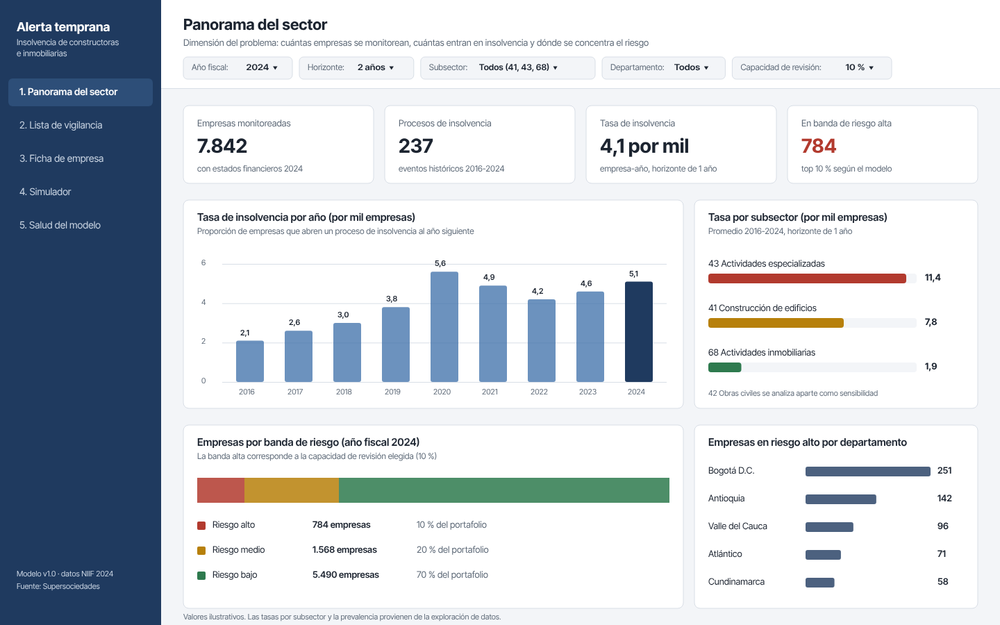
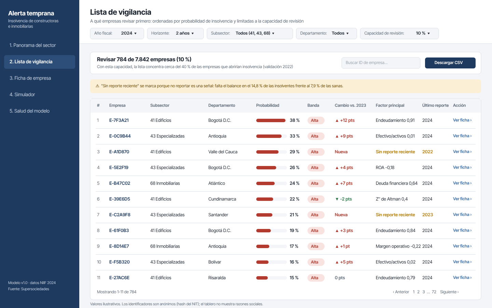
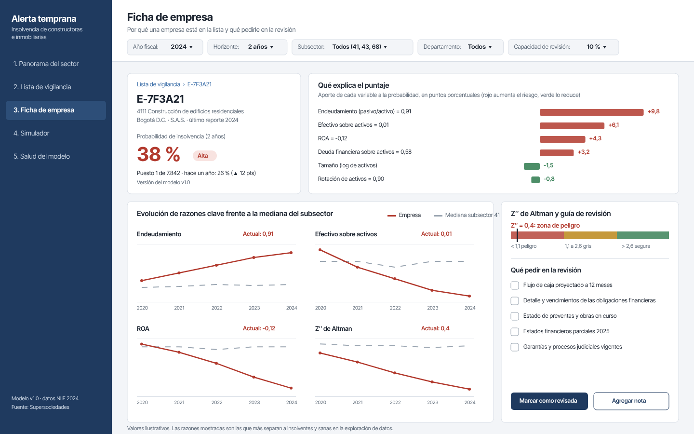
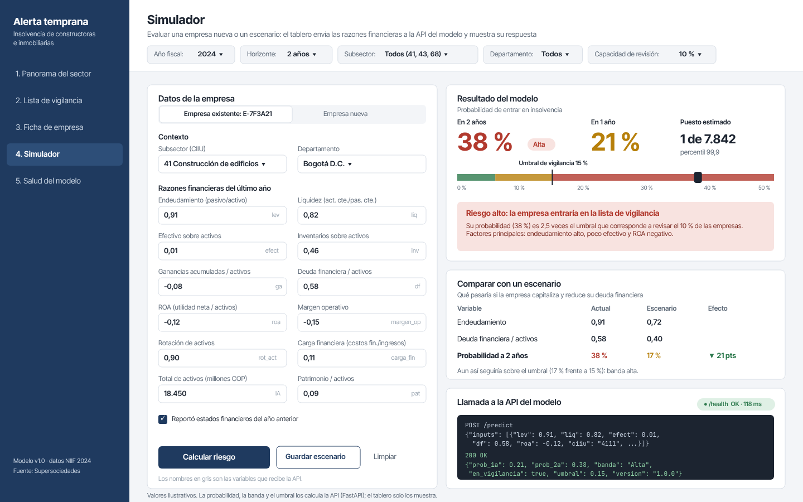
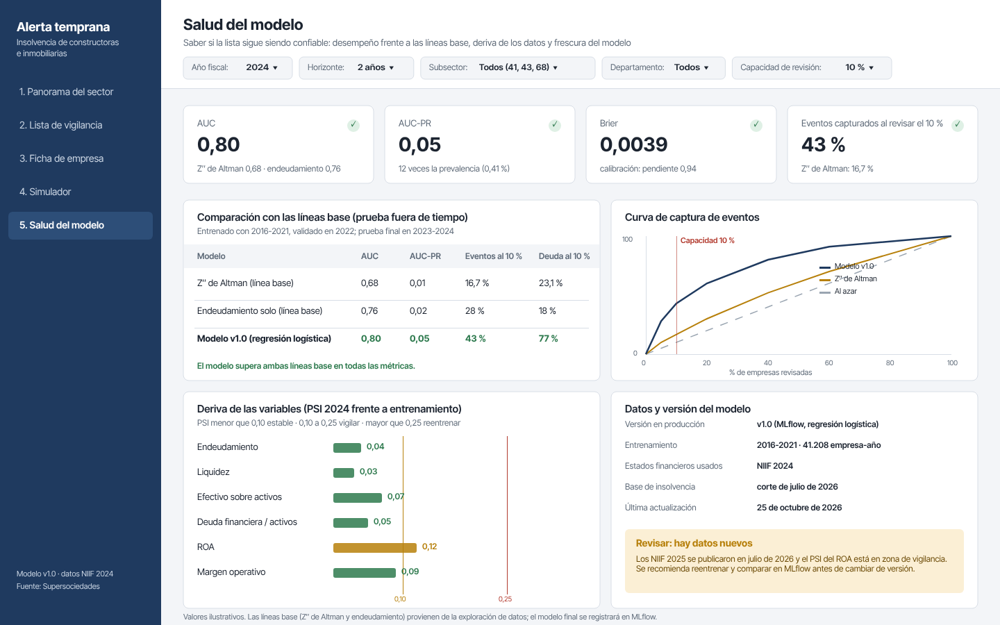

# Maqueta del prototipo (Entrega 1)

Tablero web para la **alerta temprana de insolvencia de constructoras e inmobiliarias**. El tablero consume la API
del modelo (`POST /predict`, FastAPI) y muestra además información descriptiva del sector. La maqueta tiene cinco
pantallas de 1440 × 900, diseñadas en Penpot y exportadas como imágenes en `pantallas/`.

```
mockup/
├── README.md                 este documento
└── pantallas/
    ├── 01_panorama_sector.png
    ├── 02_lista_vigilancia.png
    ├── 03_ficha_empresa.png
    ├── 04_simulador_api.png
    └── 05_salud_modelo.png
```

**Pregunta de negocio:** ¿cómo identificar, con al menos un año de anticipación y con capacidad de revisión limitada,
las constructoras e inmobiliarias que entrarán en un proceso de insolvencia?

**Usuario:** analista de riesgo de crédito que debe decidir a qué empresas revisar primero.

## Elementos comunes a todas las pantallas

| Elemento | Para qué sirve |
|---|---|
| Barra de navegación con las cinco vistas | Recorrer el flujo: del panorama a la decisión sobre una empresa |
| Filtros globales: año fiscal, **horizonte (1 o 2 años)**, **subsector (41, 43, 68 y 42 como sensibilidad)** y departamento | La exploración mostró que el horizonte operativo es de dos años (el 98,9 % de los estados se radica al año siguiente) y que el riesgo no es homogéneo entre subsectores |
| **Capacidad de revisión** (por defecto 10 %) | Traduce la restricción del analista: solo puede revisar una fracción del portafolio |
| Identificadores anonimizados de empresa | El tablero no expone razones sociales de empresas con alerta |

## Pantallas

| # | Pantalla | Qué muestra | Decisión que apoya | Hallazgo de la exploración que la justifica |
|---|---|---|---|---|
| 1 | **Panorama del sector** | Empresas monitoreadas, eventos históricos, tasa de insolvencia por mil empresas por año y por subsector, distribución de las bandas de riesgo | Dimensionar el problema y decidir en qué subsectores enfocar la revisión | Evento raro (prevalencia 0,41 % a un año); la tasa cambia con el calendario (deriva); edificios (7,8 por mil) y actividades especializadas (11,4 por mil) concentran los eventos frente a inmobiliarias (1,9 por mil) |
| 2 | **Lista de vigilancia** | Empresas ordenadas por probabilidad de insolvencia, limitadas a la capacidad de revisión; banda de riesgo, cambio frente al año anterior, factor principal y marca de "sin reporte reciente" | **A qué empresas revisar primero** (la respuesta directa a la pregunta de negocio) | La ausencia de reporte es informativa (falta el balance en 14,8 % de las insolventes frente a 7,9 % de las sanas) y solo el 38 % de los eventos tiene estados del año anterior |
| 3 | **Ficha de empresa** | Probabilidad y banda, factores que más empujan el puntaje, evolución de las razones clave frente a la mediana del subsector y Z″ de Altman | Entender **por qué** una empresa está en la lista y qué pedirle en la revisión | Las razones que más separan son endeudamiento (mediana 0,72 frente a 0,35), efectivo sobre activos, Z″ de Altman, ROA y deuda financiera sobre activos |
| 4 | **Simulador** | Formulario con las razones financieras de una empresa; el tablero llama a la API `/predict` y muestra la probabilidad, la banda y la versión del modelo | Evaluar una empresa nueva o un escenario (por ejemplo, más deuda) antes de aprobar o renovar un crédito | Es la integración tablero → API que exige el proyecto; los campos del formulario corresponden a las variables del modelo |
| 5 | **Salud del modelo** | AUC, AUC-PR, Brier y lift al revisar el 10 %, comparados con las líneas base; frescura de los datos y versión del modelo | Confiar (o no) en la lista y saber cuándo reentrenar | La línea base es débil (Z″ de Altman AUC 0,68 y 16,7 % de eventos anticipados al revisar el 10 %; endeudamiento AUC 0,76), así que el modelo debe superarlas; la deriva temporal exige monitoreo |

## Vista de cada pantalla

### 1. Panorama del sector


### 2. Lista de vigilancia


### 3. Ficha de empresa


### 4. Simulador (conectado a la API del modelo)


El analista ingresa o ajusta las razones financieras de una empresa y pulsa **Calcular riesgo**. El tablero envía
esas variables a la API y muestra lo que el modelo responde:

| Lo que muestra | De dónde sale |
|---|---|
| Probabilidad de entrar en insolvencia a 1 y 2 años | Campos `prob_1a` y `prob_2a` de la respuesta de `/predict` |
| Banda de riesgo (alta, media o baja) | Campo `banda`, según los cortes de la capacidad de revisión |
| Veredicto: "entraría en la lista de vigilancia" | Campo `en_vigilancia`: la probabilidad supera el umbral del 10 % de revisión (`umbral`) |
| Comparación con un escenario (por ejemplo, menos deuda) | Una segunda llamada a `/predict` con las variables modificadas |
| Estado del servicio y versión del modelo | `GET /health` y campo `version` |

Ejemplo de llamada (los nombres de las variables son los del panel: `lev`, `liq`, `efect`, `inv`, `ga`, `df`, `lA`,
`pat`, `roa`, `margen_op`, `rot_act`, `carga_fin`):

```json
POST /predict
{"inputs": [{"lev": 0.91, "liq": 0.82, "efect": 0.01, "df": 0.58, "roa": -0.12, "ciiu": "4111"}]}

200 OK
{"prob_1a": 0.21, "prob_2a": 0.38, "banda": "Alta", "en_vigilancia": true, "umbral": 0.15, "version": "1.0.0"}
```

La probabilidad no afirma que la empresa vaya a quebrar: sirve para priorizar a quién revisar primero.

### 5. Salud del modelo


## Flujo de uso

1. El analista entra al **panorama**, fija el año fiscal, el horizonte y su capacidad de revisión.
2. Va a la **lista de vigilancia** y obtiene las empresas a revisar, priorizadas por probabilidad.
3. Abre la **ficha** de cada empresa para ver qué la explica y preparar la revisión.
4. Usa el **simulador** cuando necesita evaluar una empresa o un escenario que no está en la lista.
5. Consulta la **salud del modelo** para verificar que el ordenamiento sigue siendo confiable.

## Relación con la arquitectura

El tablero (Dash) no calcula probabilidades: las pide a la API (FastAPI), que carga el paquete del modelo. Las
pantallas descriptivas (panorama, evolución de razones) leen la tabla `resumen_empresas`. Tablero y API se
despliegan en contenedores Docker.

*Los valores numéricos de las pantallas son ilustrativos, salvo los que provienen de la exploración de datos
(`notebooks/01_exploracion_datos.ipynb`), que se citan arriba.*
